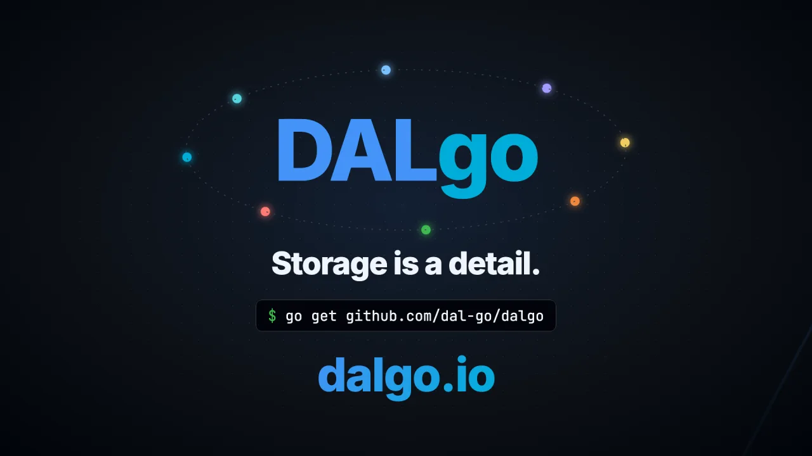

# [DALgo](https://dalgo.io/) - Database Abstraction Layer in Go language

https://dalgo.io/

Provides a consistent, flexible & implementation agnostic Go API for working with different types of databases.
By providing a single interface for different types of databases, Dalgo allows developers to write code that is agnostic to the underlying data store.
This can help reduce development time and improve code maintainability, while also providing the flexibility to choose the data store that best suits their needs.

It includes an easy-to-use API for querying, inserting, updating, and deleting records, as well as features for handling errors and logging. It also supports transactions.

## ▶ Watch

   
  ▶ <b><a href="https://youtu.be/w0ARYlWoG9g">Watch: DALgo in 79 seconds</a></b>

How it works (1:45): [swap the adapter, the developer walkthrough](https://youtu.be/wtkqlcjfzQA)

## 🛡️ Portable Access Policies

DALgo can turn any database handle into an adapter-independent capability:
extensions, tenants, background jobs, analytics, and support tools receive only
the paths and operations they need. The boundary covers point reads, queries,
batches, mutations, and transactions before an adapter is called.

- Hierarchical `Allow(path).Deny(subpath)` and
  `Deny(path).Allow(selectedSubpaths...)` rules.
- Independent `Get`, `Exists`, `Query`, `Insert`, `Set`, `Update`, `Delete`,
  and reserved `Truncate` permissions—write never implies read.
- Global and context-bound policies compose by intersection, so added policy
  layers can only narrow access.
- YAML-first, JSON-equivalent documents load from any storage through
  `io.Reader`.
- Custom SQL text is an opaque query capability, denied unless a policy grants
  it explicitly; path rules never authorize SQL by parsing its text.
- Explainable denials identify the operation, resource, policy source, and
  winning rule for trusted logs and developer tooling.
- The same matcher supports independent audit-event selection without
  granting data access.

Explore the [interactive access-policies overview](https://dalgo.io/access-policies/)
or read the [complete repository guide](https://github.com/dal-go/dalgo/blob/main/docs/access-policies.md).

## DALgo in DataTug development

DALgo provides the data-access seam in [DataTug](https://datatug.app)’s development ecosystem. Read [how DataTug’s development tools were built](https://datatug.app/en/under-the-hood/tools-we-built/).

## 📦 Modules & Packages

- [`github.com/dal-go/dalgo`](https://github.com/dal-go/dalgo) - core package. Go there for docs & more details. Consider giving it a ⭐ 😉.

### 🧪 Mocks for your tests
- [`github.com/dal-go/mocks4dalgo`](https://github.com/dal-go/mocks4dalgo) - makes testing your code that uses Dalgo easier.

### 🔌 Adapters to databases

#### Relational & SQL Engines
- [`github.com/dal-go/dalgo2sql`](https://github.com/dal-go/dalgo2sql) - Base adapter using standard Go `database/sql` with structured query compilers.
- [`github.com/dal-go/dalgo2postgres`](https://github.com/dal-go/dalgo2postgres) - PostgreSQL adapter with structured queries, DDL, and schema reader.
- [`github.com/dal-go/dalgo2sqlite`](https://github.com/dal-go/dalgo2sqlite) - SQLite adapter with structured queries, DDL, and schema reader.
- [`github.com/dal-go/dalgo2mysql`](https://github.com/dal-go/dalgo2mysql) - MySQL adapter.
- [`github.com/dal-go/dalgo2mssql`](https://github.com/dal-go/dalgo2mssql) - Microsoft SQL Server adapter.
- [`github.com/dal-go/dalgo2oracle`](https://github.com/dal-go/dalgo2oracle) - Oracle Database adapter.
- [`github.com/dal-go/dalgo2duckdb`](https://github.com/dal-go/dalgo2duckdb) - DuckDB embedded analytical database adapter.
- [`github.com/dal-go/dalgo2libsql`](https://github.com/dal-go/dalgo2libsql) - libSQL / Turso distributed SQLite adapter.
- [`github.com/dal-go/dalgo2d1`](https://github.com/dal-go/dalgo2d1) - Cloudflare D1 SQL database adapter.

#### Cloud Data Warehouses & Analytics
- [`github.com/dal-go/dalgo2bigquery`](https://github.com/dal-go/dalgo2bigquery) - Google Cloud BigQuery adapter.
- [`github.com/dal-go/dalgo2snowflake`](https://github.com/dal-go/dalgo2snowflake) - Snowflake cloud data warehouse adapter.
- [`github.com/dal-go/dalgo2databricks`](https://github.com/dal-go/dalgo2databricks) - Databricks SQL warehouse adapter (AWS, Azure, GCP).
- [`github.com/dal-go/dalgo2athena`](https://github.com/dal-go/dalgo2athena) - Amazon Athena serverless query engine adapter.
- [`github.com/dal-go/dalgo2clickhouse`](https://github.com/dal-go/dalgo2clickhouse) - ClickHouse column-oriented database adapter.

#### NoSQL, Document & Key-Value Stores
- [`github.com/dal-go/dalgo2firestore`](https://github.com/dal-go/dalgo2firestore) - Google Cloud Firestore adapter.
- [`github.com/dal-go/dalgo2datastore`](https://github.com/dal-go/dalgo2datastore) - Google Cloud Datastore (App Engine) adapter.
- [`github.com/dal-go/dalgo2mongodb`](https://github.com/dal-go/dalgo2mongodb) - MongoDB document database adapter.
- [`github.com/dal-go/dalgo2couchdb`](https://github.com/dal-go/dalgo2couchdb) - Apache CouchDB document database adapter.
- [`github.com/dal-go/dalgo2cosmosdb`](https://github.com/dal-go/dalgo2cosmosdb) - Azure Cosmos DB adapter.
- [`github.com/dal-go/dalgo2dynamodb`](https://github.com/dal-go/dalgo2dynamodb) - Amazon DynamoDB NoSQL database adapter.
- [`github.com/dal-go/dalgo2redis`](https://github.com/dal-go/dalgo2redis) - Redis in-memory data store adapter.
- [`github.com/dal-go/dalgo2cloudflarekv`](https://github.com/dal-go/dalgo2cloudflarekv) - Cloudflare Workers KV adapter.
- [`github.com/dal-go/dalgo2convex`](https://github.com/dal-go/dalgo2convex) - Convex reactive backend-as-a-service adapter.
- [`github.com/dal-go/dalgo2openvaultdb`](https://github.com/dal-go/dalgo2openvaultdb) - OpenVaultDB encrypted database adapter.
- [`github.com/dal-go/dalgo2elasticsearch`](https://github.com/dal-go/dalgo2elasticsearch) - Elasticsearch search and analytics engine adapter.
- [`github.com/dal-go/dalgo2typesense`](https://github.com/dal-go/dalgo2typesense) - Typesense fast search engine adapter.
- [`github.com/dal-go/dalgo2influxdb`](https://github.com/dal-go/dalgo2influxdb) - InfluxDB time-series database adapter.

#### Web, HTTP, Git & File Stores
- [`github.com/dal-go/dalgo2http`](https://github.com/dal-go/dalgo2http) - HTTP/REST API adapter.
- [`github.com/dal-go/dalgo2postgrest`](https://github.com/dal-go/dalgo2postgrest) - PostgREST RESTful API adapter.
- [`github.com/dal-go/dalgo2git`](https://github.com/dal-go/dalgo2git) - Git repository as a data store.
- [`github.com/dal-go/dalgo2files`](https://github.com/dal-go/dalgo2files) - Local filesystem document storage adapter.
- [`github.com/dal-go/dalgo2logs`](https://github.com/dal-go/dalgo2logs) - Structured log storage adapter.
- [`github.com/dal-go/dalgo2namecheap`](https://github.com/dal-go/dalgo2namecheap) - Namecheap API adapter.

#### Built-In & Testing Adapters
- [`dalgo2memory`](https://github.com/dal-go/dalgo/tree/main/adapters/dalgo2memory) - Built-in in-memory adapter for unit testing and local development.
- [`dalgo2fs`](https://github.com/dal-go/dalgo/tree/main/adapters/dalgo2fs) - Built-in filesystem-backed adapter.
- [`github.com/dal-go/dalgo2badger`](https://github.com/dal-go/dalgo2badger) - Badger key-value store (legacy).
- [`github.com/dal-go/dalgo2buntdb`](https://github.com/dal-go/dalgo2buntdb) - BuntDB in-memory database (legacy).

#### Ecosystem & Partner Adapters
- [`github.com/ingitdb/dalgo2ingitdb`](https://github.com/ingitdb/dalgo2ingitdb) - inGitDB Git-native database adapter.

All qualified adapters are passing [`dalgo-end2end-tests`](https://github.com/dal-go/dalgo-end2end-tests). If you developed an adapter and it passes the end-to-end tests it can be added here - please submit a PR.

# 🍿 Demo & Examples of usage
- [github.com/dal-go/dalgo-demo](https://github.com/dal-go/dalgo-demo)

# 🔥 Used by
- [`github.com/bots-go-framework`](https://github.com/bots-go-framework)
- [datatug-cli](https://github.com/datatug/datatug-cli) - Context-aware data viewer & collaborative query manager for effortless exploration of related data — CLI + Web UI

Submit a PR for adding a link here if you use Dalgo in your open source project.
